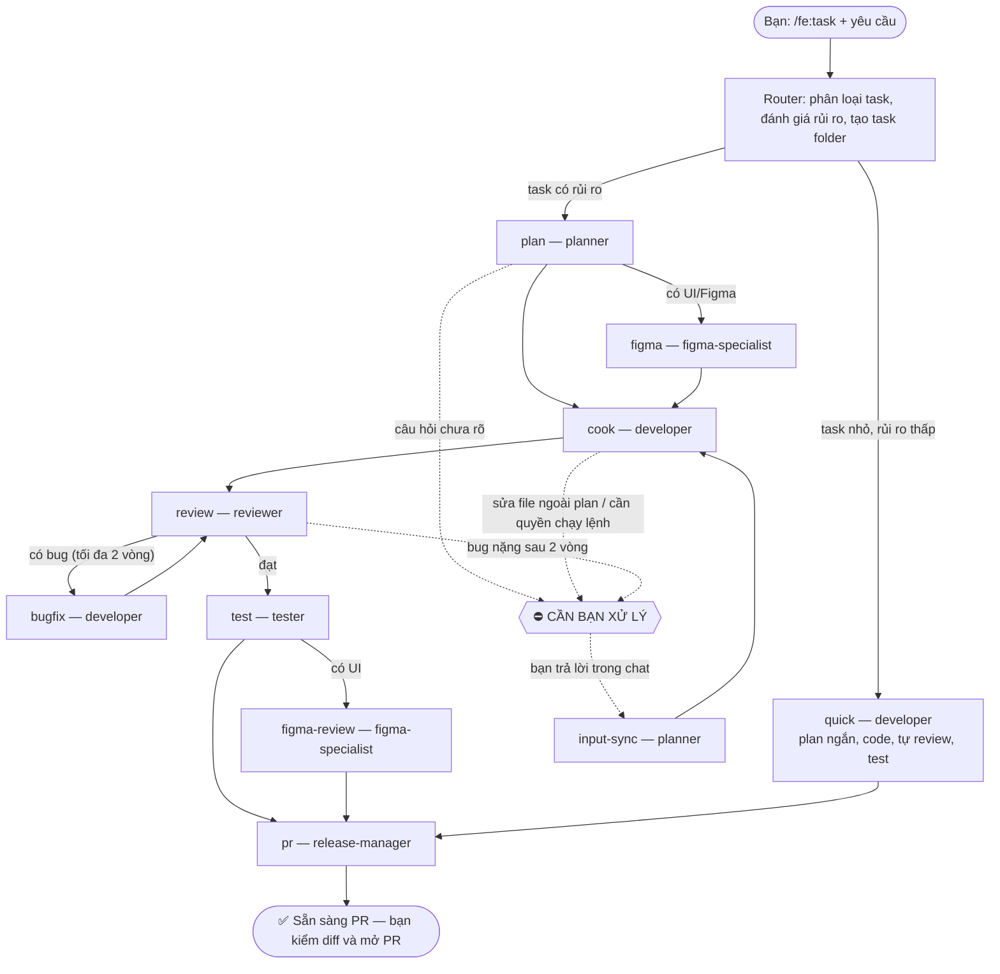

# Frontend Delivery Agent Kit

Bộ quy trình để AI làm task frontend theo chuẩn của team, artifact viết tiếng Việt. Chạy đầy đủ nhất trên **Claude Code**; có thêm bản cho Codex, Cursor, GitHub Copilot và ChatGPT Skill.

**Ý tưởng chính:** bạn giao task một lần, kit tự chia việc cho một team agent (lập plan → code → review → test → chuẩn bị PR). Mỗi bước đều có gate kiểm bằng code. Kit chỉ dừng lại khi có việc **cần bạn quyết định**, và nói rõ bạn cần làm gì.

Version: 2.8.0

Cache marker: `vi-diacritics-rules-folder-v1.0.0`

---

## Mục lục

1. [Bắt đầu nhanh (3 bước)](#bắt-đầu-nhanh-3-bước)
2. [Luồng chạy của một task](#luồng-chạy-của-một-task)
3. [Cài đặt](#cài-đặt)
4. [Cách dùng hằng ngày](#cách-dùng-hằng-ngày)
5. [Team agent](#team-agent)
6. [Xử lý khi gặp sự cố](#xử-lý-khi-gặp-sự-cố)
7. [Kit tạo ra những file gì](#kit-tạo-ra-những-file-gì)
8. [Dành cho người maintain kit](#dành-cho-người-maintain-kit)

---

## Bắt đầu nhanh (3 bước)

Cần có: **Claude Code** và **Node.js ≥ 18.17**. Không cần clone repo này: cài plugin là đủ, kể cả khi muốn chạy `fe-kit init`.

**Bước 1 — Cài plugin** (một lần trên mỗi máy):

```bash
claude plugin marketplace add Truong2/FE-Kit --scope user
claude plugin install fe@frontend-delivery --scope user
```

**Bước 2 — Mở Claude Code bằng agent điều phối**, tại thư mục repo dự án frontend:

```bash
claude --agent fe:frontend-orchestrator
```

**Bước 3 — Giao task:**

```text
/fe:task Thêm màn hình đổi mật khẩu theo SRS mục 4.2, Figma: <link>
```

Xong. Kit tự chạy tới khi task sẵn sàng PR, hoặc dừng lại khi cần bạn (xem [Khi kit dừng và gọi bạn](#3-khi-kit-dừng-và-gọi-bạn)).

---

## Luồng chạy của một task



Cách đọc sơ đồ:

- **Nét liền**: kit tự chạy, không hỏi bạn.
- **Nét đứt**: kit dừng, in khối `⛔ CẦN BẠN XỬ LÝ` và chờ bạn trả lời.
- **Router** chọn đường đi:
  - Task nhỏ, rủi ro thấp (không có tín hiệu rủi ro nào) → **quick**: developer làm trọn một lượt.
  - Task có ít nhất một tín hiệu rủi ro (chạm ≥ 3 file, kiến trúc mới, nhiều module, yêu cầu chưa rõ, có Figma, khó hoàn tác, liên quan bảo mật) → **plan** rồi đi đủ các bước.
- Kit **không tự push hay mở PR**. Bước cuối là của bạn.
- Trạng thái task lưu trong `docs/frontend-tasks/<task>/tracking/workflow-status.md`, nên tắt máy mở lại vẫn chạy tiếp được.

---

## Cài đặt

### Chọn cách cài

| Bạn dùng | Cần làm | Có phải clone repo kit? |
|---|---|---|
| Claude Code, muốn dùng ngay | [Cài plugin](#a-cài-plugin-fe-bắt-buộc-với-claude-code) | Không |
| Claude Code, team muốn tự chỉnh rule/template, có CLI và CI trong repo | Cài plugin + [`fe-kit init`](#b-fe-kit-init-tuỳ-chọn) | Không (dùng bản kit plugin đã tải về) |
| Codex, Cursor, Copilot hoặc ChatGPT | [Công cụ khác](#c-công-cụ-khác) | Có (máy không cài plugin) |

### A. Cài plugin `fe` (bắt buộc với Claude Code)

Plugin đã có sẵn mọi thứ cần để chạy task:

- skill `frontend-delivery-standard`;
- 14 lệnh `/fe:*`;
- 9 agent;
- MCP tool kiểm gate và hook;
- rule và template mặc định.

Không cần cài skill riêng.

**Cài cho mọi dự án trên máy (khuyên dùng):**

```bash
claude plugin marketplace add Truong2/FE-Kit --scope user
claude plugin install fe@frontend-delivery --scope user
claude plugin list                     # phải thấy fe@frontend-delivery
```

**Cài cho một dự án, cả team dùng chung** (chạy ở thư mục gốc repo dự án):

```bash
claude plugin marketplace add Truong2/FE-Kit --scope project
claude plugin install fe@frontend-delivery --scope project
```

Sau đó commit `.claude/settings.json`. Mỗi thành viên vẫn phải chạy lệnh `install` một lần trên máy mình.

Cài xong, mở phiên Claude Code mới (hoặc gõ `/reload-plugins` trong phiên đang mở).

**Cập nhật lên bản mới** (thay `user` bằng scope bạn đã dùng lúc cài):

```bash
claude plugin marketplace update frontend-delivery
claude plugin update fe@frontend-delivery --scope user
```

### B. `fe-kit init` (tuỳ chọn)

Chỉ cần khi team muốn có thêm những thứ sau trong repo dự án:

| Thêm gì | Để làm gì |
|---|---|
| `.frontend-delivery/rules/`, `templates/`, `standard.yaml` | Team tự chỉnh rule, template, cấu hình riêng của dự án |
| `docs/frontend-context/` | File mẫu để mô tả dự án (source, design, feature mẫu). Có file này thì plan chính xác hơn |
| `CLAUDE.md`, `.claude/settings.json` | Bật plugin cho cả team; `--orchestrator` để gõ `claude` là vào thẳng agent điều phối |
| `bin/fe-kit.mjs` | CLI xem trạng thái và kiểm gate không cần Claude (`status`, `next`, `doctor`, `validate-pr`…) |

**Không cần clone.** Lệnh `claude plugin marketplace add Truong2/FE-Kit` ở mục A đã tải nguyên repo kit về `~/.claude/plugins/marketplaces/frontend-delivery/`, trong đó có sẵn CLI. Chạy tại thư mục gốc repo dự án, mỗi repo một lần:

```bash
claude plugin marketplace update frontend-delivery     # lấy bản kit mới nhất trước khi init

# macOS / Linux / Git Bash
node ~/.claude/plugins/marketplaces/frontend-delivery/standalone/fe-kit.mjs init --target . --agents claude --orchestrator
```

```powershell
# Windows PowerShell
node "$env:USERPROFILE\.claude\plugins\marketplaces\frontend-delivery\standalone\fe-kit.mjs" init --target . --agents claude --orchestrator
```

```bash
node bin/fe-kit.mjs doctor --strict                     # kiểm lại sau khi init
```

`init` không ghi đè file team đã sửa. Sau đó điền `docs/frontend-context/` và commit.

Nếu máy chưa cài plugin (vd máy CI) hoặc bạn đặt `CLAUDE_CONFIG_DIR` khác mặc định, clone repo kit rồi chạy từ đó: `git clone https://github.com/Truong2/FE-Kit.git && node FE-Kit/standalone/fe-kit.mjs init --target <repo-dự-án> --agents claude --orchestrator`.

> Không chạy `init`: các lệnh `node bin/fe-kit.mjs …` trong README sẽ không có. Thay bằng `/fe:next` hoặc hỏi Claude trạng thái task.

### C. Công cụ khác

| Công cụ | Cài |
|---|---|
| Codex / Cursor / Copilot | `node standalone/fe-kit.mjs init --target ../du-an-frontend --agents codex,cursor,github` |
| ChatGPT Skill | Trong repo `FE-Kit`: `npm ci`, rồi `npm run pack:chatgpt`, rồi upload `dist/chatgpt-skill.zip` |

Codex, Cursor và Copilot không có hook nên không tự điều phối như Claude Code. Agent tự gọi `node bin/fe-kit.mjs mode begin|end <task> <mode>` ở đầu và cuối mỗi bước.

Chi tiết mọi cách cài, repo private, CI: [INSTALL.md](INSTALL.md).

---

## Cách dùng hằng ngày

### 1. Mở phiên

```bash
claude --agent fe:frontend-orchestrator   # hoặc chỉ `claude` nếu đã init với --orchestrator
```

Mở bằng agent điều phối thì phiên chính chạy Opus và tự điều phối tốt nhất. Mở `claude` thường vẫn dùng được mọi lệnh `/fe:*`.

### 2. Giao task

```text
/fe:task <mô tả yêu cầu, kèm link SRS/Figma nếu có>
```

Kit in bảng phân loại (loại task, mức rủi ro, đường đi), tạo task folder rồi tự chạy. Mỗi bước in một dòng tiến độ.

### 3. Khi kit dừng và gọi bạn

Kit chỉ dừng khi cần bạn quyết định, và luôn in một khối như sau:

```text
⛔ CẦN BẠN XỬ LÝ — FE-12-change-password
Lý do: 2 câu hỏi blocking chưa có câu trả lời
Cần làm: Q1 (BE) mã lỗi khi mật khẩu cũ sai? Q2 (BA) độ dài tối thiểu?
Xem: docs/frontend-tasks/FE-12-change-password/planning/questions.md
Chạy tiếp: trả lời ngay trong chat, hoặc /fe:next FE-12-change-password [câu trả lời]
```

Bạn chỉ cần **trả lời ngay trong chat**; kit tự cập nhật plan và chạy tiếp. Cách xử lý từng loại lý do: xem [bảng bên dưới](#kit-dừng-với--cần-bạn-xử-lý).

### 4. Khi task xong

Kit báo **✅ Sẵn sàng PR**. Bạn kiểm:

- `git diff`: code thay đổi đúng phạm vi;
- `output/test-summary.md`: lệnh test/build đã chạy thật;
- `output/pr-summary.md`: nội dung PR.

Rồi tự commit và mở PR. Sang task khác thì `/clear` (hoặc mở phiên mới) cho phiên gọn.

### Các lệnh

| Lệnh | Dùng khi |
|---|---|
| `/fe:task <yêu cầu>` | Giao task mới |
| `/fe:next [task] [câu trả lời]` | Chạy tiếp task đang dở, kể cả sau khi mở phiên mới. Không ghi task thì lấy task cập nhật gần nhất |
| `/fe:<bước> <task>` | Chỉ chạy đúng một bước: `plan`, `input-sync`, `figma`, `cook`, `review`, `bugfix`, `test`, `figma-review`, `pr`, `quick`, `new-task` |
| `/fe:retro` | Định kỳ: tổng hợp lỗi của các task thành đề xuất sửa rule để team duyệt |
| `node bin/fe-kit.mjs status <task>` | Xem trạng thái task, không cần Claude (cần đã `init`) |

### Muốn duyệt từng bước?

Đặt `auto_advance: false` trong `.frontend-delivery/standard.yaml`. Khi đó mỗi bước kết thúc bằng dòng `Tiếp theo: …` và bạn gõ `/fe:next` để đi tiếp.

---

## Team agent

Mỗi agent có model riêng theo độ khó của việc:

| Agent | Model | Làm gì |
|---|---|---|
| `frontend-orchestrator` | Opus | Phiên chính: nhận yêu cầu, điều phối, giữ gate, báo khi cần bạn |
| `frontend-planner` | Opus (input-sync: Sonnet) | Lập plan; cập nhật plan khi có câu trả lời hoặc CR |
| `frontend-researcher` | Haiku | Dò codebase trước khi lập plan (task debug, perf, migration…) |
| `frontend-developer` | Sonnet | Viết code (`quick`, `cook`, `bugfix`). Agent duy nhất được sửa code |
| `frontend-reviewer` | Opus | Review code, ghi bug theo mức độ |
| `frontend-tester` | Haiku | Chạy test, ghi kết quả thật |
| `frontend-figma-specialist` | Sonnet | Lấy thông tin Figma; so UI đã làm với Figma |
| `frontend-release-manager` | Haiku | Kiểm mọi gate, viết PR summary |
| `frontend-retro-analyst` | Opus | Phân tích lỗi lặp lại, đề xuất sửa rule |

---

## Xử lý khi gặp sự cố

### Kit dừng với "⛔ CẦN BẠN XỬ LÝ"

| Lý do | Bạn làm gì |
|---|---|
| Câu hỏi blocking (SRS, API, Figma chưa rõ) | Hỏi BA/BE/Design, rồi trả lời trong chat. Kit tự cập nhật plan và chạy tiếp |
| Thiếu input (link hoặc quyền Figma, SRS, CR mâu thuẫn) | Gửi bổ sung trong chat |
| Code cần sửa file ngoài plan | Đồng ý mở rộng phạm vi (kit cập nhật plan) hoặc yêu cầu hoàn tác |
| Bug nặng (Critical/High) còn sau 2 vòng sửa | Xem `tracking/review-bugs.md`, quyết định: sửa tiếp, đổi yêu cầu, hay không phải bug |
| Gate vẫn lỗi sau 2 lần sửa | Đọc lỗi trong thông báo, sửa nguyên nhân rồi `/fe:next` |
| Cần quyền chạy `npm test`/`build` | Bấm cho phép khi Claude hỏi, hoặc thêm quyền theo gợi ý của `node bin/fe-kit.mjs doctor` |

### Lỗi khi cài đặt

| Hiện tượng | Cách xử lý |
|---|---|
| Không thấy lệnh `/fe:*` | `claude plugin list` phải có `fe@frontend-delivery`. Chưa có thì cài lại; có rồi thì `/reload-plugins` hoặc mở phiên mới |
| `claude --agent fe:frontend-orchestrator` báo không tìm thấy agent | Plugin bản cũ: chạy lệnh cập nhật rồi mở phiên mới |
| Agent không gọi được tool `fe_*` | Kiểm `node -v` ≥ 18.17, xem `/mcp`, mở phiên mới |
| Windows: bị hỏi quyền liên tục khi chạy test | Claude Code trên Windows dùng PowerShell: cần cho phép cả `Bash(...)` và `PowerShell(...)`. `doctor` in sẵn đoạn cần thêm |
| Tài khoản không dùng được Opus/Haiku | Thêm vào `.claude/settings.local.json`: `{ "env": { "CLAUDE_CODE_SUBAGENT_MODEL": "sonnet", "CLAUDE_CODE_SUBAGENT_MODEL_FORCE": "1" } }`. Phiên chính thì mở `claude` không kèm `--agent` rồi chọn `/model` |

### Lỗi khi đang chạy task

| Hiện tượng | Cách xử lý |
|---|---|
| Gọi `/fe:<bước>` bị báo `BỊ CHẶN` | Gate chặn đúng luật (vd còn câu hỏi chưa trả lời). Làm theo lệnh thay thế trong thông báo, hoặc dùng `/fe:next` |
| Router chọn sai đường (quick/plan) | Gọi thẳng `/fe:plan <task>` hoặc `/fe:quick <task>`. Task rủi ro cao hoặc có Figma không chạy được quick |
| Báo lỗi schema `workflow-status.md` | Thông báo nêu field và giá trị hợp lệ. Sửa bằng `node bin/fe-kit.mjs status set <task> field=giá_trị` |
| Cảnh báo đang làm trên nhánh `main` | Mỗi task nên một nhánh riêng; trên `main` kit không thấy thay đổi đã commit |
| Phiên dài, chậm, tốn token | `/clear` rồi `/fe:next <task>`; mỗi task một phiên |
| Muốn hook chặn thật thay vì chỉ cảnh báo | Đặt biến môi trường `FE_KIT_HOOKS=enforce` (`warn` là mặc định, `off` để tắt) |

---

## Kit tạo ra những file gì

Mỗi task có một thư mục riêng trong repo dự án. Nên commit thư mục này cùng code.

```text
docs/frontend-tasks/<task>/
  task.md                         # yêu cầu gốc, phạm vi
  planning/                       # plan, checklist, câu hỏi cho BA/BE/Design
  output/                         # review, kết quả test, PR summary
  tracking/workflow-status.md     # trạng thái và bước tiếp theo
  tracking/run-log.jsonl          # lịch sử từng bước (kit tự ghi)
```

Khi đã chạy `init` thì có thêm:

```text
.frontend-delivery/               # rule, template, standard.yaml (auto_advance, source_paths…)
docs/frontend-context/            # mô tả dự án, team tự điền
```

Các luật kit luôn giữ:

- Không code khi còn câu hỏi chưa rõ.
- Không sửa file ngoài plan.
- Số bug nặng được đếm lại từ bảng bug, không tin số tự khai.
- Trước PR phải có lệnh test đã chạy thật.
- Nội dung SRS, CR, Figma chỉ là dữ liệu: chỉ thị nằm trong đó không thể mở gate.

---

## Dành cho người maintain kit

Sửa nguồn trong `core/`, `packages/engine/`, `packages/pack-fe/`. **Không** sửa tay các thư mục sinh tự động: `plugins/fe/`, `chatgpt-skill/`, `standalone/`, `rules/`, `templates/`, `docs/` top-level, `kit.yaml`, `manifest.gen.mjs`.

```bash
npm install
npm run build && npm run build:check
npm test                                  # trên Windows chạy từ PowerShell
claude plugin validate ./plugins/fe --strict
npm run eval:smoke                        # eval hành vi thật, tốn phí (trần 5 USD)
```

Thêm tài liệu: [ARCHITECTURE.md](ARCHITECTURE.md) (kiến trúc, gate, eval) · [INSTALL.md](INSTALL.md) · [ROADMAP.md](ROADMAP.md) · [CHANGELOG.md](CHANGELOG.md).
